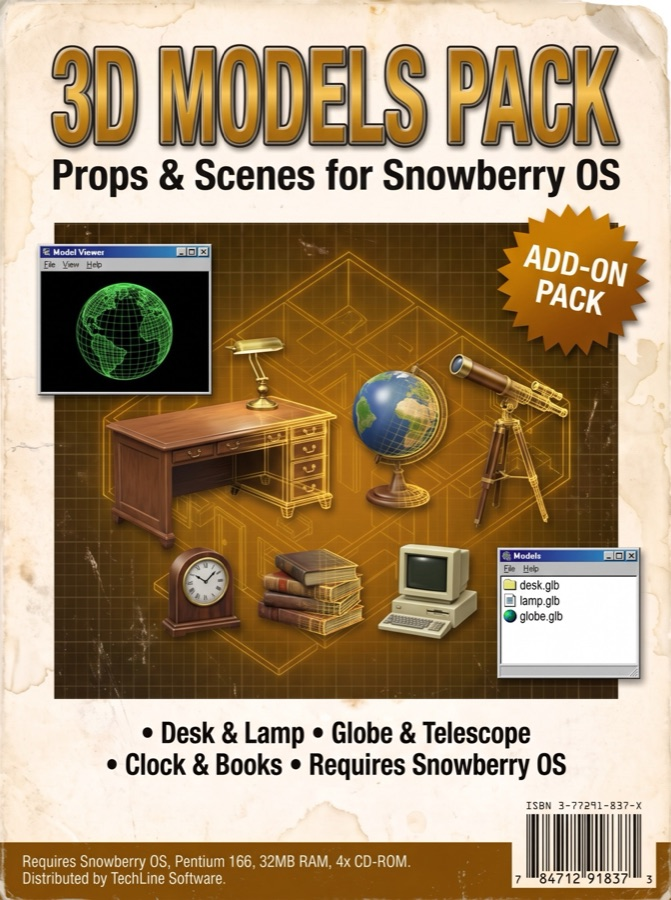
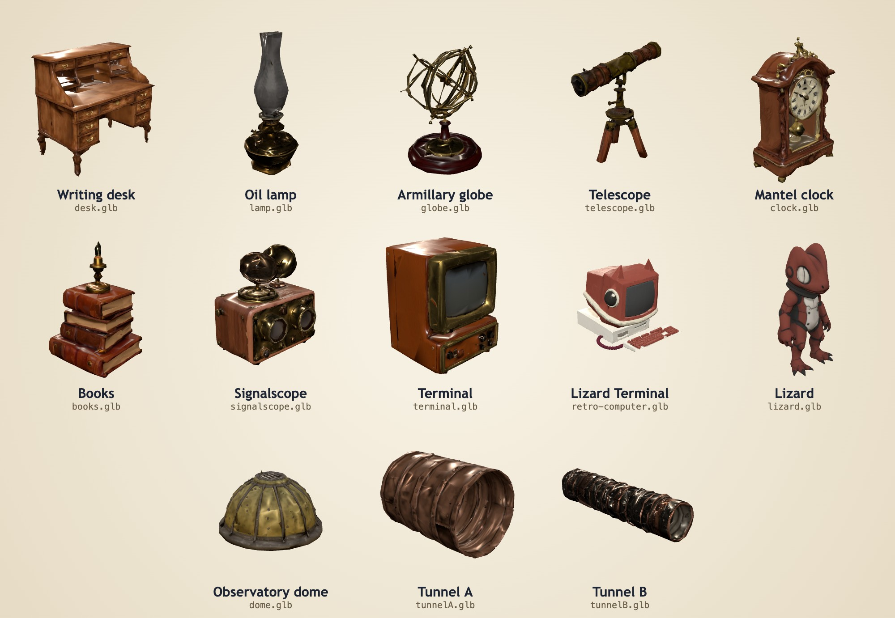
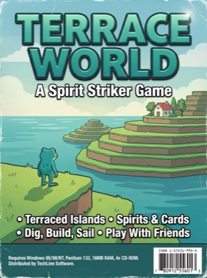
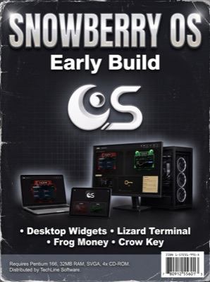
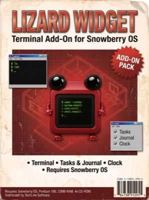
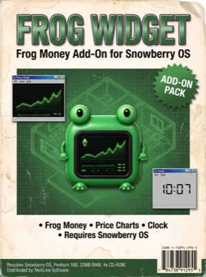
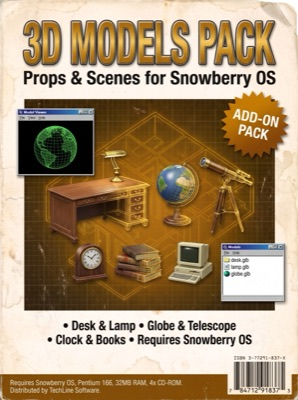
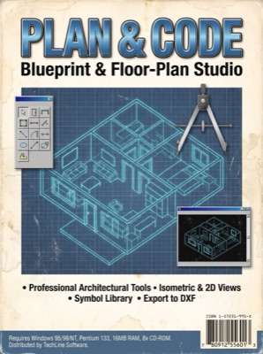
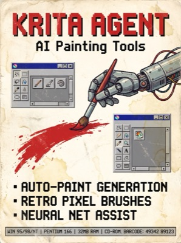
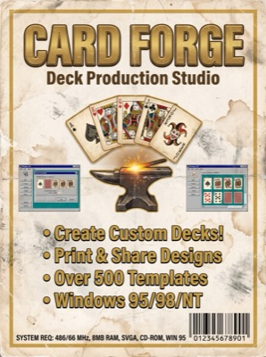

# 3D Models Pack



Thirteen 3D models from the Spirit Strikers site and Snowberry OS: the props from the observatory study, the terminals, and the lizard. Free to use.



## The models

| File | What it is | Triangles | Size |
|---|---|---:|---:|
| `models/desk.glb` | Writing desk | 5,268 | 224 KB |
| `models/lamp.glb` | Oil lamp | 2,243 | 210 KB |
| `models/globe.glb` | Armillary globe | 2,272 | 206 KB |
| `models/telescope.glb` | Telescope | 2,612 | 297 KB |
| `models/clock.glb` | Mantel clock | 5,721 | 258 KB |
| `models/books.glb` | Books | 2,386 | 205 KB |
| `models/signalscope.glb` | Signalscope | 4,232 | 313 KB |
| `models/terminal.glb` | Terminal | 2,066 | 180 KB |
| `models/retro-computer.glb` | Lizard Terminal | 79,960 | 934 KB |
| `models/lizard.glb` | Lizard | 3,261 | 112 KB |
| `models/dome.glb` | Observatory dome | 3,400 | 252 KB |
| `models/tunnelA.glb` | Tunnel A | 4,155 | 225 KB |
| `models/tunnelB.glb` | Tunnel B | 2,182 | 311 KB |

All of them are binary glTF (`.glb`) with their textures inside, 3.7 MB in total.

## Use them

They are packed small for the web: meshopt-compressed geometry (`EXT_meshopt_compression`, `KHR_mesh_quantization`) and WebP textures (`EXT_texture_webp`). In three.js, give the loader the meshopt decoder:

```js
import { GLTFLoader } from 'three/addons/loaders/GLTFLoader.js';
import { MeshoptDecoder } from 'three/addons/libs/meshopt_decoder.module.js';

const loader = new GLTFLoader();
loader.setMeshoptDecoder(MeshoptDecoder);
const { scene } = await loader.loadAsync('models/desk.glb');
```

A tool that cannot read those extensions needs the file unpacked first, for example with [glTF-Transform](https://gltf-transform.dev).

```bash
git clone https://github.com/Frog-dex/3d-models-pack.git
```

## How they were made

Blu generated them with Tripo from his own prompts and reference art, cleaned them up in Blender, and compressed them with glTF-Transform.

## Not in this pack

The Spirit Strikers site also uses a few models made by other people. They are not Blu's to relicense, so they are not here: the WebXR generic hand (MIT, Amazon), the Godot XR Tools hand (CC0, DigitalN8m4r3), two Kenney props (CC0), and five Poly Pizza models (CC BY 3.0: Jarlan Perez, Guillaume Brette, Bruno Oliveira, the Google Poly archive, Charlie).

## The Sovereign Software shelf

Every box on the Spirit Strikers software shelf. Put the discs in the terminal here: https://frog-dex.github.io/terrace-world/library.html#software

| <a href="https://github.com/Frog-dex/terrace-world"></a> |  |  |  |
|:--:|:--:|:--:|:--:|
| **Terrace World**<br>the game | **Snowberry OS**<br>early build, not released yet | **Lizard Widget**<br>add-on, not released yet | **Frog Widget**<br>add-on, not released yet |

| <a href="https://github.com/Frog-dex/3d-models-pack"></a> | <a href="https://github.com/Frog-dex/plan-and-code"></a> | <a href="https://github.com/Frog-dex/krita-agent"></a> | <a href="https://github.com/Frog-dex/card-forge"></a> |
|:--:|:--:|:--:|:--:|
| **3D Models Pack**<br>thirteen free models | **Plan & Code**<br>plan a page, hand it to an AI | **Krita Agent**<br>AI tools inside Krita | **Card Forge**<br>card-making studio |

## Licence

The models are released under [Creative Commons Attribution 4.0](https://creativecommons.org/licenses/by/4.0/): use them for anything, with credit to "Blu Inman, Spirit Strikers". See [LICENSE.md](LICENSE.md). The Spirit Strikers name, characters and brand remain © Blu Inman.
