# 3D Models Pack

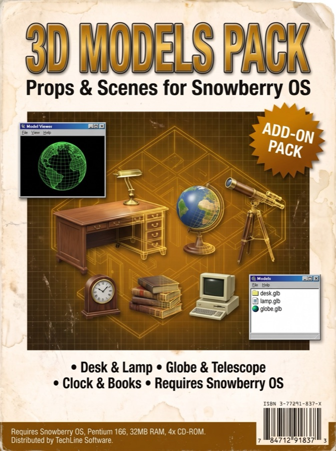

Thirteen 3D models from the Spirit Strikers site and Snowberry OS: the props from the observatory study, the terminals, and the lizard. Free to use.

**Browse them in 3D:** <https://frog-dex.github.io/3d-models-pack/> (the gallery, a Model Viewer for every file, and the Observatory Study scene; published by GitHub Pages, see [The gallery](#the-gallery)).

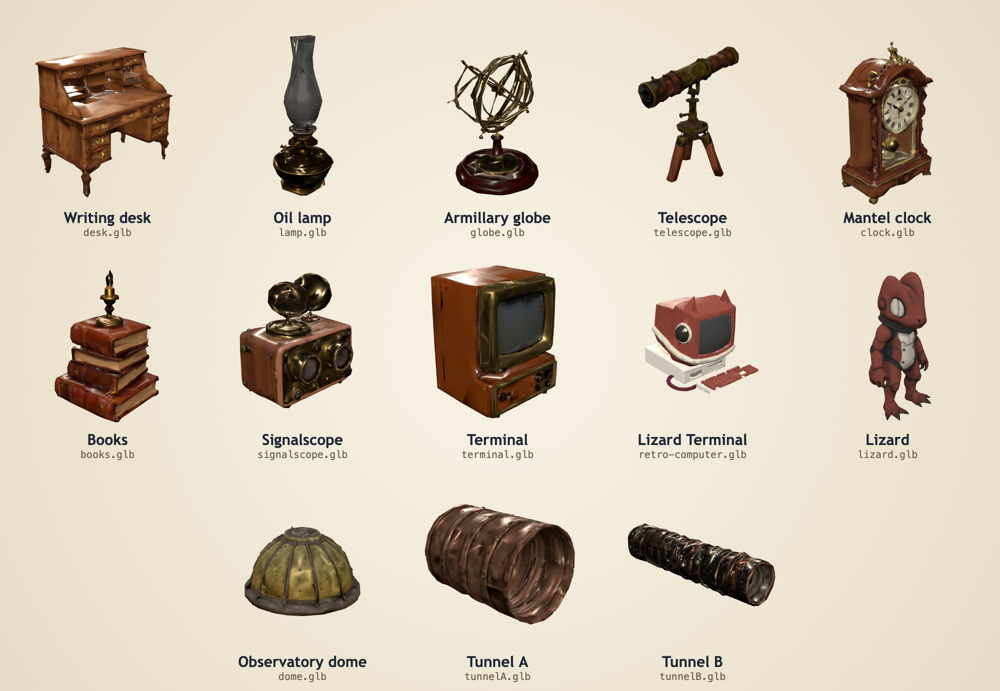

## The models

| File | What it is | Triangles | Size |
|---|---|---:|---:|
| `models/desk.glb` | Writing desk | 5,268 | 224 KB |
| `models/lamp.glb` | Oil lamp | 2,243 | 210 KB |
| `models/globe.glb` | Armillary globe | 2,272 | 206 KB |
| `models/telescope.glb` | Telescope | 2,612 | 297 KB |
| `models/clock.glb` | Mantel clock | 5,721 | 258 KB |
| `models/books.glb` | Books | 2,386 | 205 KB |
| `models/signalscope.glb` | Signalscope | 4,232 | 313 KB |
| `models/terminal.glb` | Terminal | 2,066 | 180 KB |
| `models/retro-computer.glb` | Lizard Terminal | 79,960 | 934 KB |
| `models/lizard.glb` | Lizard | 3,261 | 112 KB |
| `models/dome.glb` | Observatory dome | 3,400 | 252 KB |
| `models/tunnelA.glb` | Tunnel A | 4,155 | 225 KB |
| `models/tunnelB.glb` | Tunnel B | 2,182 | 311 KB |

All of them are binary glTF (`.glb`) with their textures inside, 3.7 MB in total.

## Use them

They are packed small for the web: meshopt-compressed geometry (`EXT_meshopt_compression`, `KHR_mesh_quantization`) and WebP textures (`EXT_texture_webp`). In three.js, give the loader the meshopt decoder:

```js
import { GLTFLoader } from 'three/addons/loaders/GLTFLoader.js';
import { MeshoptDecoder } from 'three/addons/libs/meshopt_decoder.module.js';

const loader = new GLTFLoader();
loader.setMeshoptDecoder(MeshoptDecoder);
const { scene } = await loader.loadAsync('models/desk.glb');
```

A tool that cannot read those extensions needs the file unpacked first, for example with [glTF-Transform](https://gltf-transform.dev).

```bash
git clone https://github.com/Frog-dex/3d-models-pack.git
```

## The gallery

The repo is also a small website with no build step: plain HTML, CSS and ES modules, with three.js loaded from a CDN.

| Gallery | Model Viewer | Wireframe mode |
|:--:|:--:|:--:|
| 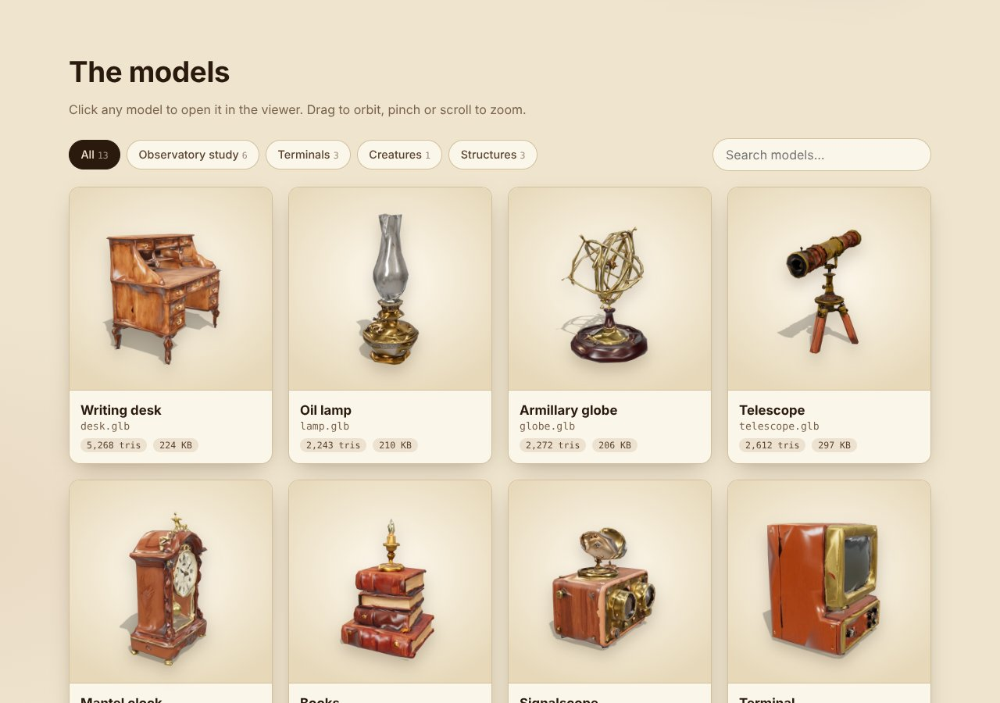 | 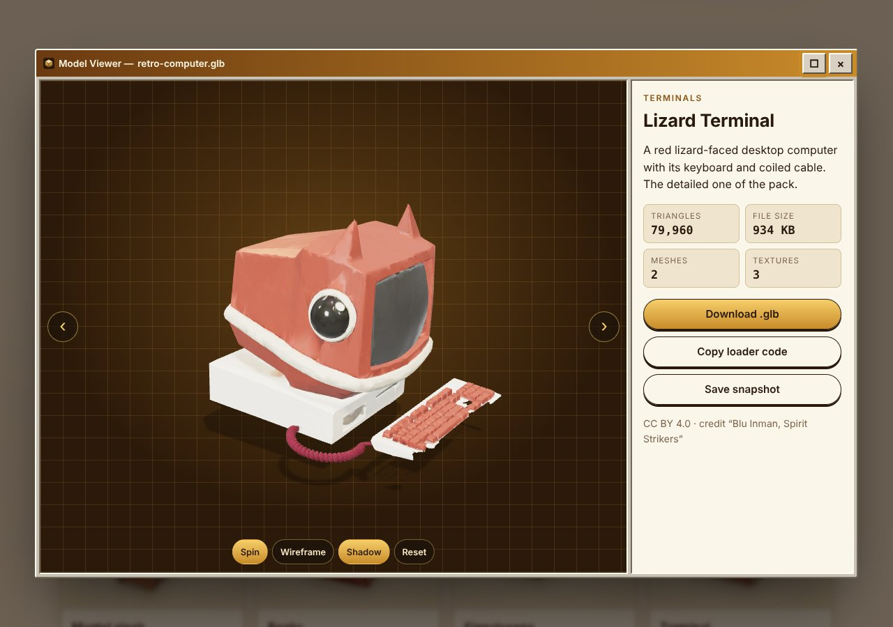 | 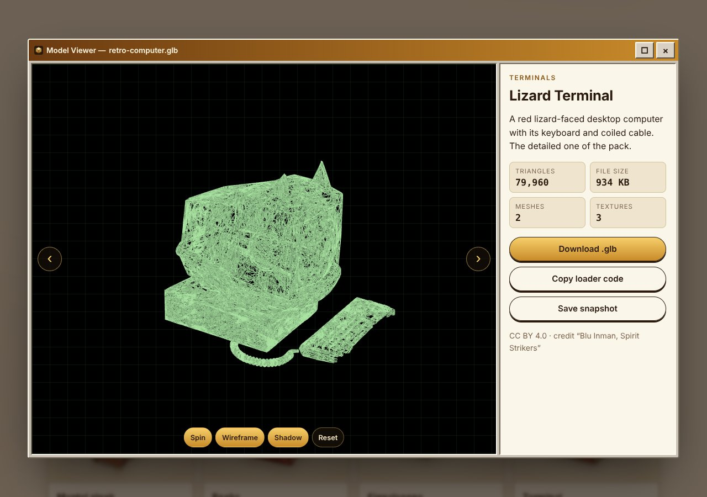 |

- **Gallery** (`index.html`): every model as a card with its triangle count and size. Filter by group or search.
- **Model Viewer**: a Snowberry OS window. Orbit, zoom, spin, wireframe and shadow toggles, previous/next with the arrow keys, full screen, *Download .glb*, *Copy loader code* and *Save snapshot*. Each model has its own link, for example `index.html#model/lizard`.
- **The Observatory Study** (`study.html`): all thirteen models in one room under a star-chart ceiling. The desk holds the lamp, books and clock, and the lizard stands by it. Tap a prop to fly to it, and pick the dome to step outside and see the room in cutaway.

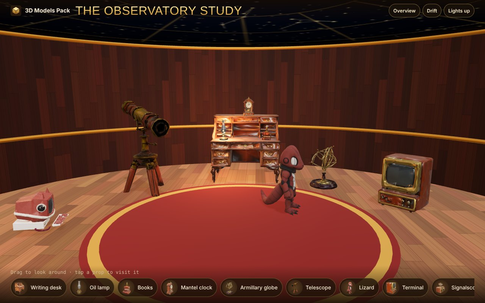

It works on phones too:

| Home | Viewer | Study |
|:--:|:--:|:--:|
| 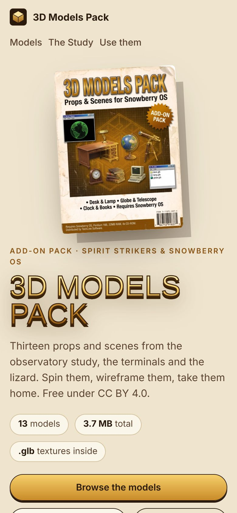 | 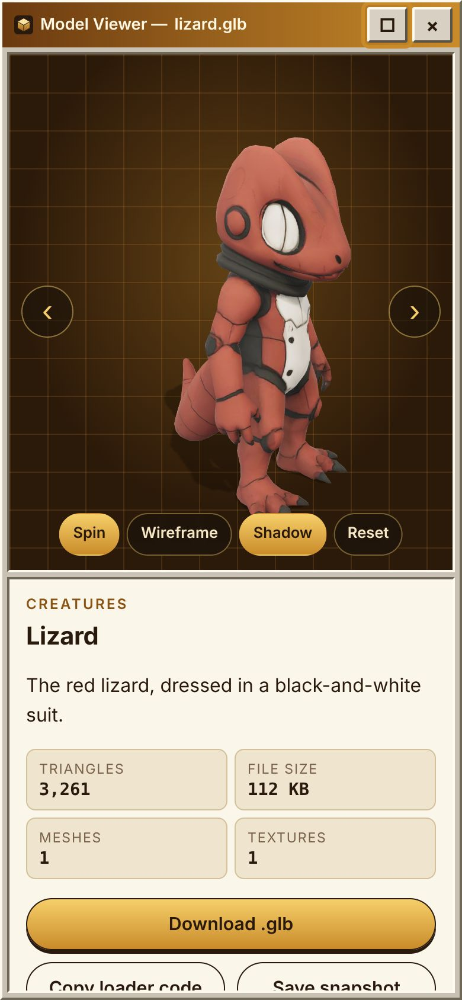 | 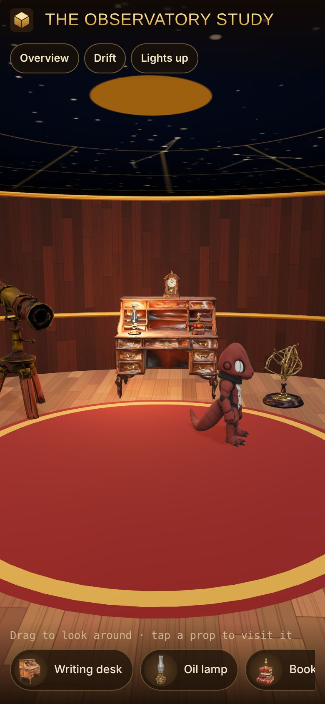 |

### Run it locally

```bash
npm install     # dev tools only; the site has no runtime dependencies
npm start       # http://localhost:8080
```

Any static file server works too (`python3 -m http.server`). Opening `index.html` straight from disk does not, because browsers block module imports from `file://`.

### Scripts

| Command | What it does |
|---|---|
| `npm start` | Serves the site at http://localhost:8080 |
| `npm run check` | Runs every `.glb` through the Khronos glTF validator and checks its triangle count and file size against `site/catalog.js` |
| `npm test` | `check`, then a headless-Chromium smoke test of the gallery, the viewer and the Study |
| `npm run thumbs` | Re-renders the card thumbnails in `docs/thumbs/` (pass ids to render only some: `npm run thumbs -- desk lamp`) |
| `npm run screenshot` | Re-takes the README screenshots in `docs/` |

The scripts that use a browser need Playwright's Chromium (`npx playwright install chromium`). They serve three.js from `node_modules`, so they also run offline.

### Adding a model

1. Put the compressed `.glb` in `models/`.
2. Add an entry to `MODELS` in `site/catalog.js`. Run `npm run check` and it tells you the exact triangle count and byte size to fill in.
3. Run `npm run thumbs -- <id>` and, if the model belongs in the room, give it a spot in `LAYOUT` in `site/study.js`.
4. Add a row to the table at the top of this README.

### Layout

```
models/            the thirteen .glb files
docs/              box art, the README images and thumbs/ for the gallery cards
index.html         gallery + Model Viewer
study.html         the Observatory Study scene
site/catalog.js    names, groups and stats for every model (single source of truth)
site/stage.js      shared three.js setup: loader with meshopt, lights, shadows, camera framing
site/app.js        gallery and viewer logic
site/study.js      the Study scene
scripts/           dev server, model checker, thumbnail and screenshot renderers, smoke test
```

GitHub Actions runs `npm test` on every push and pull request (`.github/workflows/ci.yml`), and publishes the site to GitHub Pages from `main` (`.github/workflows/pages.yml`).

## How they were made

Blu generated them with Tripo from his own prompts and reference art, cleaned them up in Blender, and compressed them with glTF-Transform.

## Not in this pack

The Spirit Strikers site also uses a few models made by other people. They are not Blu's to relicense, so they are not here: the WebXR generic hand (MIT, Amazon), the Godot XR Tools hand (CC0, DigitalN8m4r3), two Kenney props (CC0), and five Poly Pizza models (CC BY 3.0: Jarlan Perez, Guillaume Brette, Bruno Oliveira, the Google Poly archive, Charlie).

## The Sovereign Software shelf

Every box on the Spirit Strikers software shelf. Put the discs in the terminal here: https://frog-dex.github.io/terrace-world/library.html#software

| <a href="https://github.com/Frog-dex/terrace-world">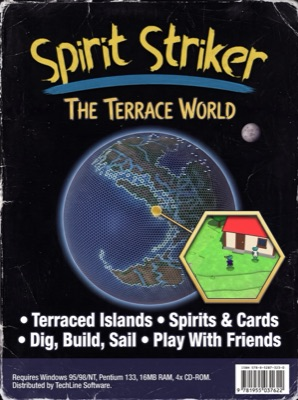</a> | 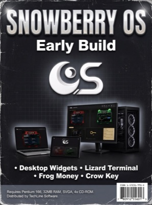 | 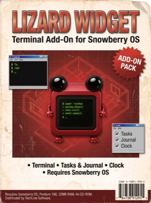 | 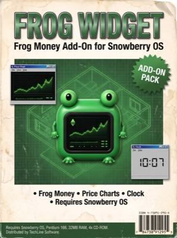 |
|:--:|:--:|:--:|:--:|
| **Terrace World**<br>the game | **Snowberry OS**<br>early build, not released yet | **Lizard Widget**<br>add-on, not released yet | **Frog Widget**<br>add-on, not released yet |

| <a href="https://github.com/Frog-dex/3d-models-pack">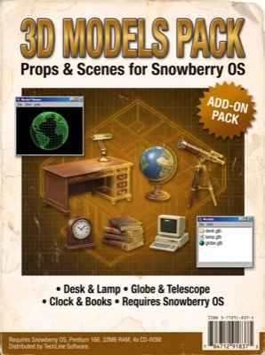</a> | <a href="https://github.com/Frog-dex/plan-and-code">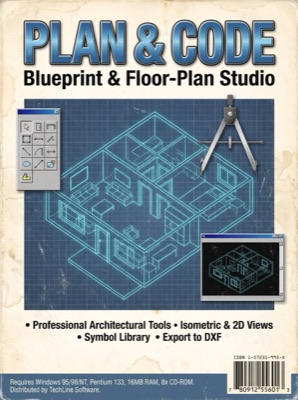</a> | <a href="https://github.com/Frog-dex/krita-agent">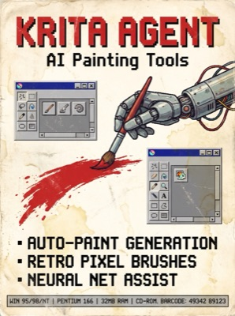</a> | <a href="https://github.com/Frog-dex/card-forge">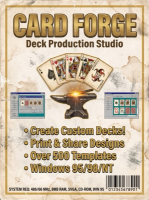</a> |
|:--:|:--:|:--:|:--:|
| **3D Models Pack**<br>thirteen free models | **Plan & Code**<br>plan a page, hand it to an AI | **Krita Agent**<br>AI tools inside Krita | **Card Forge**<br>card-making studio |

## Licence

The models are released under [Creative Commons Attribution 4.0](https://creativecommons.org/licenses/by/4.0/): use them for anything, with credit to "Blu Inman, Spirit Strikers". See [LICENSE.md](LICENSE.md). The Spirit Strikers name, characters and brand remain © Blu Inman.
